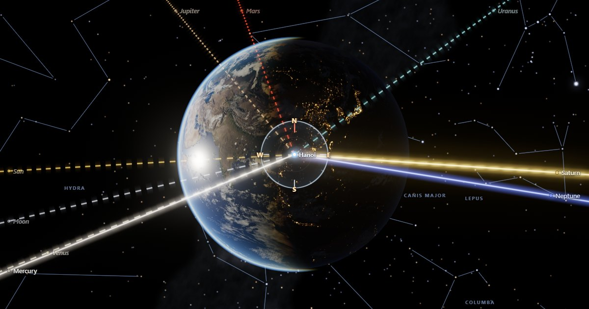

# Planet Location Marker


**Stand anywhere on Earth and see where every world is, right now.**

Planet Location Marker is a real-time 3D globe. It draws a beam of light from wherever you stand
to the Sun, the Moon and every planet, and shows the real star sky around them. Step outside onto
the ground to see the same beams become your line of sight. All the astronomy is computed in your
browser, and nothing needs the network.

## [→ Open Planet Location Marker](https://anshler.github.io/planet-location-marker/)

[](https://anshler.github.io/planet-location-marker/)

---

## Features

- **A beam to every world.**
  - Nine glowing beams, one each for the Sun, the Moon and the seven planets, leave your location
    toward where each body is now.
  - The direction is corrected for the light's travel time.
  - Pulses run along each beam from the planet toward you while time runs fast.
  - A beam to a body below your horizon dives through the Earth as a faint dashed "x-ray".
- **A living Earth.**
  - Day and night with a soft, warm twilight band.
  - City lights only on the night side.
  - Sun glint on the oceans, clouds with their shadows, and an atmosphere that glows blue at the
    limb and orange along the terminator.
- **The true sky.**
  - 5,044 Hipparcos stars at their catalogue positions, coloured by temperature.
  - The 88 constellations with names, and the Milky Way.
  - Bright-star names and optional equatorial grid, ecliptic and horizon grid.
- **The Moon at true scale and distance.** Its phase and libration are right by construction,
  and the Earth's shadow falls on it during a lunar eclipse.
- **Eclipses happen on their own.** The Moon's shadow crosses the Earth at the right place and
  time. Jump to an eclipse from the Events panel and fly over the shadow.
- **Sky view.** Press <kbd>V</kbd> to drop down to the ground. You stand under a daylight sky
  driven by the real Sun, the stars fade in with twilight, and there are cardinal points and an
  alt-az grid.
- **A time machine.**
  - Live mode, or any speed from −1 year/s to +1 year/s.
  - Steps of a minute, an hour, a day, a sidereal day, a lunar month or a year.
  - A scrubber shaded by day and night, a time-lapse loop between two dates, and any year from
    1000 to 3000.
- **Sky Now and body details.**
  - For every body: altitude and azimuth with a compass arrow, rise, transit and set, magnitude,
    phase, distance, elongation and constellation.
  - RA and Dec, both J2000 and of date.
  - "Tonight" verdicts, and a light-time sentence such as "The light you see from Saturn left
    1 h 21 min ago".
- **Events for the next 12 months:**
  - Moon phases;
  - oppositions and conjunctions;
  - greatest elongations;
  - lunar and solar eclipses, including whether one is visible from where you are;
  - equinoxes and solstices.
- **Put yourself anywhere, offline.**
  - Search about 1,600 cities, with no network needed.
  - Click the globe (with Undo), type coordinates in decimal or DMS, or use your location.
  - Online place search is an optional extra.
- **Deep links.** Every view is a shareable URL: place, time, speed, selection, layers and camera.
- **Fast everywhere.**
  - Three quality tiers, with an automatic governor that steps down when frames get slow.
  - The scene renders only when something changes.
  - A text mode with full sky tables on devices without WebGL 2.
- **Accessible.** Full keyboard control, screen-reader announcements, and support for
  `prefers-reduced-motion`.

## Keyboard shortcuts

| Key | Action |
|---|---|
| <kbd>Space</kbd> | Play / pause |
| <kbd>[</kbd> / <kbd>]</kbd> | Slower / faster |
| <kbd>R</kbd> | Reverse time |
| <kbd>,</kbd> / <kbd>.</kbd> | Step −/+ 1 hour |
| <kbd>Shift</kbd>+<kbd>,</kbd> / <kbd>.</kbd> | Step −/+ 1 day |
| <kbd>Alt</kbd>+<kbd>,</kbd> / <kbd>.</kbd> | Step −/+ 1 sidereal day |
| <kbd>N</kbd> | Now (Live) |
| <kbd>1</kbd>–<kbd>9</kbd> | Select the Sun, Moon, Mercury … Neptune |
| <kbd>0</kbd> or <kbd>Esc</kbd> | Deselect / close a dialog |
| <kbd>V</kbd> | Globe ↔ Sky view |
| <kbd>L</kbd> | Lock the view to the Earth |
| <kbd>B</kbd> <kbd>C</kbd> <kbd>Shift</kbd>+<kbd>C</kbd> <kbd>M</kbd> <kbd>E</kbd> <kbd>G</kbd> <kbd>O</kbd> <kbd>T</kbd> | Beams, constellation lines, constellation names, Milky Way, ecliptic, equatorial grid, visibility footprint, path of the selected body |
| <kbd>/</kbd> or <kbd>Ctrl</kbd>/<kbd>⌘</kbd>+<kbd>K</kbd> | Search places |
| <kbd>S</kbd> | Share a link to this view |
| <kbd>F</kbd> | Fullscreen |
| <kbd>H</kbd> | Hide the interface |
| <kbd>?</kbd> | Help |
| Arrows · <kbd>+</kbd> / <kbd>−</kbd> · <kbd>Home</kbd> | Rotate or look around · zoom · reset the camera |

## Running locally

Requires [Node.js](https://nodejs.org/) 22 or later, for the dev server and tests only. There are
no dependencies to install and no build step.

```sh
npm start            # serves the site at http://localhost:8080
npm test             # unit tests (node:test, zero dependencies)
npm run smoke        # headless Chrome: boots with every external host blocked and checks the
                     # SPEC acceptance criteria (needs Chrome or Edge; set CHROME_PATH if needed)
npm run size         # transfer-size budgets per quality tier
```

Maintenance scripts:

- `npm run vendor` re-fetches the pinned third-party files and verifies their SHA-256.
- `npm run data` rebuilds `data/sky.json`, `data/milkyway.png` and `data/cities.json` from
  `data/raw/`.

Useful URL options (in the hash):

- `#intro=0` skips the first-visit intro.
- `#debug=1` shows the performance overlay.
- `#q=low` forces a quality tier.
- `#t=2027-02-06T16:00:00Z&p=0` freezes time at a moment.

## Accuracy

Positions come from [Astronomy Engine](https://github.com/cosinekitty/astronomy), which uses VSOP87
for the planets and a full lunar theory for the Moon, with IAU 2006 precession, IAU 2000B nutation
and ΔT. They are accurate to about **1 arcminute between 1800 and 2200**. Accuracy degrades
gradually outside that range, mostly because the Earth's past and future rotation (ΔT) is
uncertain, and the app marks those years "Reduced accuracy".

- **What is drawn.** Beams and glyphs show *astrometric J2000* directions, so they line up with
  the star catalogue.
- **What the tables show.** The tables give the *apparent* positions an observer would measure:
  of date, with aberration and atmospheric refraction.
- **The difference** is at most about 20″, plus refraction near the horizon.
- **Clouds** are illustrative, not live weather.

[docs/ASTRONOMY.md](docs/ASTRONOMY.md) covers the frames, formulas, error budget and sources.

## How it is built

- Plain ES modules loaded straight from `index.html`, with three.js r170 and Astronomy Engine
  vendored.
- Pure, tested astronomy and state modules.
- A render-on-demand frame loop.
- A custom shader for each layer: Earth, atmosphere, sky, beams and ground.

[docs/ARCHITECTURE.md](docs/ARCHITECTURE.md) covers the module map, data flow, frame loop, quality
tiers and failure handling.

## Deploying

The site is plain static files.

- **GitHub Pages, recommended.** In the repository, open **Settings → Pages → Build and deployment
  → Source: GitHub Actions**. Every push to `main` then runs CI, which covers the tests, the size
  budgets and the headless smoke tests. If CI passes, `.github/workflows/pages.yml` stages the site
  files and deploys them.
- **Branch deploy.** "Deploy from a branch: `main` / root" also works. `.nojekyll` is included.
- **Any static host** works too. All URLs are relative, so a sub-path is fine.

## Credits and licences

Planet Location Marker is MIT-licensed (see [LICENSE](LICENSE)). It bundles:

| What | From | Licence |
|---|---|---|
| 3D engine | [three.js](https://threejs.org/) r170 | MIT |
| Astronomy | [Astronomy Engine](https://github.com/cosinekitty/astronomy) 2.1.19 by Don Cross | MIT |
| Stars, constellations, Milky Way | ESA Hipparcos, via [d3-celestial](https://github.com/ofrohn/d3-celestial) by Olaf Frohn | BSD-3-Clause |
| Cities | [GeoNames](https://www.geonames.org/) | CC BY 4.0 |
| Earth textures | [Solar System Scope](https://www.solarsystemscope.com/textures/) and NASA Visible Earth, via the three.js examples | CC BY 4.0 / public domain |

Online place search, which is optional, uses [Open-Meteo](https://open-meteo.com/),
[Photon](https://photon.komoot.io/) and [Nominatim](https://nominatim.openstreetmap.org/), all
built on OpenStreetMap data.

[THIRD_PARTY_NOTICES.md](THIRD_PARTY_NOTICES.md) has the full notices, and
[vendor/VENDOR.json](vendor/VENDOR.json) records the exact versions and hashes.
