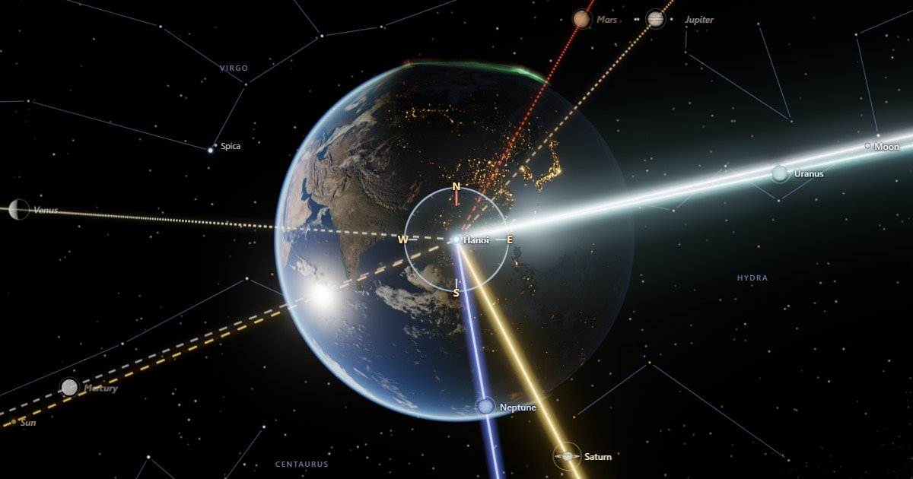

# Planet Location Marker


**Stand anywhere on Earth and see where every world is, right now.**

Planet Location Marker is a real-time 3D globe. It draws a beam of light from wherever you stand
to the Sun, the Moon and every planet, and shows the real star sky around them. Step outside onto
the ground to see the same beams become your line of sight. All the astronomy is computed in your
browser, and nothing needs the network.

## [→ Open Planet Location Marker](https://anshler.github.io/planet-location-marker/)

[](https://anshler.github.io/planet-location-marker/)

---

## Features

- **A beam to every world.**
  - Nine glowing beams, one each for the Sun, the Moon and the seven planets, leave your location
    toward where each body is now.
  - The direction is corrected for the light's travel time.
  - Pulses run along each beam from the planet toward you while time runs fast.
  - A beam to a body below your horizon dives through the Earth as a faint dashed "x-ray".
- **A living Earth.**
  - Day and night with a soft, warm twilight band.
  - City lights only on the night side.
  - Sun glint on the oceans, clouds with their shadows, and an atmosphere that glows blue at the
    limb and orange along the terminator.
- **The true sky.**
  - 5,044 Hipparcos stars at their catalogue positions, coloured by temperature.
  - The 88 constellations with names, and the Milky Way.
  - Bright-star names and optional equatorial grid, ecliptic and horizon grid.
- **The Moon at true scale and distance.** Its phase and libration are right by construction,
  and the Earth's shadow falls on it during a lunar eclipse.
- **Eclipses happen on their own.** The Moon's shadow crosses the Earth at the right place and
  time. Jump to an eclipse from the Events panel and fly over the shadow.
- **Sky view.** Press <kbd>V</kbd> to drop down to the ground. You stand under a daylight sky
  driven by the real Sun, the stars fade in with twilight, and there are cardinal points and an
  alt-az grid.
- **A time machine.**
  - Live mode, or any speed from −1 year/s to +1 year/s.
  - Step buttons that show their step (`1 h`): a minute, an hour, a day, a sidereal day, a lunar
    month or a year.
  - A scrubber in the sky's own colours (golden hour, violet twilight, indigo and night), with a
    thin band for when the Moon is up, one for the selected planet and gold bars over eclipses;
    a loop between two dates, and any year from 1000 to 3000.
  - The date button shows the time zone ("Greenwich, UTC+0", "This device, UTC+7" or "UTC") and
    opens the **Time** panel: go to a date (with quick jumps to sunset, midnight and sunrise),
    the step size, which way time runs, a loop between two moments, the time zone and the
    24-hour clock, and what the time bar's colours and marks mean.
- **Five panels: Up now, Details, Events, Explore and Display.** On a phone they sit in a tab bar
  at the bottom that is always there, under a sheet you drag up; tapping a world in the view
  raises the sheet to its details.
- **Up now and body details.**
  - For every body: altitude and azimuth with a compass arrow, rise, transit and set, magnitude,
    phase, distance, elongation and constellation.
  - RA and Dec, both J2000 and of date.
  - "Tonight" verdicts, and a light-time sentence such as "The light you see from Saturn left
    1 h 21 min ago".
  - A Tonight chart from dusk to dawn: when each world is up and how high, its best moment, and
    a drag to move through the night. Rows count down to the next rise and carry a 24-hour
    altitude sparkline.
  - A Sky dome: the whole sky in one round chart (horizon, compass points, bright stars and
    constellation figures, the ecliptic, the Moon at its phase and every planet where it stands),
    held overhead or read as a map, with a tap to select. In Sky view it also shows the camera's
    field of view.
- **Events for the next 12 months:**
  - Moon phases;
  - oppositions and conjunctions;
  - greatest elongations;
  - lunar and solar eclipses, including whether one is visible from where you are;
  - equinoxes and solstices.
  - Each event's icon shows the event itself: the Moon's real phase, both planets of a pairing,
    the actual overlap of an eclipse.
  - Add to calendar: any event, or every eclipse of the next 12 months, as an .ics file made
    offline, with a reminder 30 minutes before and a link back to that sky.
  - The next 8 weeks first, then the rest of the year; each row jumps to its event.
- **Explore.** Guided tours, the sky you were born under, Moments in history and Famous comets
  (each a link to that sky), a second place to compare with, and standing on Mars.
- **Display.** Every layer, grouped for the view you are in (the other view's layers wait in one
  closed group), Reset layers, the sky's light pollution and aurora, quality, night vision and
  About this app.
- **Put yourself anywhere, offline.**
  - Search about 1,600 cities, with no network needed. Each result shows its local time and its
    sky at that moment ('06:14 · sunrise in 12 min', 'night, Moon up').
  - Click the globe (with Undo), type coordinates in decimal or DMS, or use your location.
  - Online place search is an optional extra.
- **One toolbar, the same in every view.** `Globe | Sky | Map`, then **Tools** (on the globe:
  where to look from, Turn with the Earth, Reset the view; in Sky view: Follow, Telescope, the
  angle ruler, pointing the phone and long exposures), **Share** (link, postcard, time-lapse video)
  and **⋯** (shortcuts and mouse, interface tips, night vision, hide the interface, fullscreen,
  install, About). Every mode you enter (a viewpoint, the map, the telescope, following, the ruler,
  an exposure, a loop) shows a chip at the top of the view with its own way out, and
  <kbd>Esc</kbd> leaves the newest one first.
- **Deep links.** Every view is a shareable URL: place, time, speed, selection, layers and camera.
- **Works offline after the first visit.** The deployed site installs as a whole: every module and
  the star, city and event data are cached in the background on the first visit, so it opens with
  no network the next time. A new version downloads only what changed, waits, and says "A new
  version is ready · Reload" instead of mixing old and new files.
- **Fast everywhere.**
  - Three automatic quality tiers, with a governor that steps down when frames get slow, plus a
    manual Max (Display → Quality) with 8K Earth maps and every effect at full detail, for fast GPUs.
  - The scene renders only when something changes.
  - A text mode with full sky tables and the Sky dome on devices without WebGL 2.
  - If the graphics keep resetting (a phone short of GPU memory), it steps down a quality tier for
    the session, and after a third reset within a minute it falls back to text mode, with Retry.
- **Report a problem.** Display → About this app → Copy diagnostics copies one JSON report (version, graphics, quality
  decisions, recent errors; never your location) to paste into a new issue, which the button next
  to it opens prefilled.
- **Accessible.** Full keyboard control, screen-reader announcements, focus rings that show
  over a bright sky, and the system's display settings: `prefers-reduced-motion`,
  `prefers-reduced-transparency` (solid panels), `prefers-contrast: more` (brighter text, edged
  panels and chips) and `forced-colors` (Windows High Contrast).
- **Night vision for real observing.** Display → Night vision, <kbd>Shift</kbd>+<kbd>N</kbd> or
  the ⋯ menu turns the whole screen dim red, so your eyes stay dark-adapted, and keeps the
  screen awake (also in Sky view on a phone). It is a setting of the device, never part of a
  shared link.
- **Made for the device in your hand.** On a touch screen the tips talk in taps and drags, Help
  opens on the gestures (⋯ → Gestures and help), and a first visit ends with three short
  interface tips (⋯ → Interface tips replays them). It installs as an app: ⋯ → Install the
  app or Display → About this app, or Share → Add to Home Screen on an iPhone, with shortcuts to Sky view and Events.

## Keyboard shortcuts

| Key | Action |
|---|---|
| <kbd>Space</kbd> | Play / pause |
| <kbd>[</kbd> / <kbd>]</kbd> | Slower / faster |
| <kbd>R</kbd> | Reverse time (also Time → Time runs) |
| <kbd>,</kbd> / <kbd>.</kbd> | Step −/+ 1 hour |
| <kbd>Shift</kbd>+<kbd>,</kbd> / <kbd>.</kbd> | Step −/+ 1 day (or Shift with a step button) |
| <kbd>Alt</kbd>+<kbd>,</kbd> / <kbd>.</kbd> | Step −/+ 1 sidereal day (or Alt with a step button) |
| <kbd>N</kbd> | Now (Live) |
| <kbd>1</kbd>–<kbd>9</kbd> | Select the Sun, Moon, Mercury … Neptune |
| <kbd>0</kbd> | Deselect |
| <kbd>Esc</kbd> | Close a menu or dialog, then leave the newest mode shown at the top of the view, then clear the selection |
| <kbd>V</kbd> · <kbd>M</kbd> | Globe ↔ Sky view · world map ↔ globe |
| <kbd>L</kbd> | Turn with the Earth, or hold the view still |
| <kbd>K</kbd> · <kbd>A</kbd> | Sky view: follow the selection, then the stars, then look freely · the angle ruler |
| <kbd>B</kbd> <kbd>C</kbd> <kbd>Shift</kbd>+<kbd>C</kbd> <kbd>Shift</kbd>+<kbd>M</kbd> <kbd>E</kbd> <kbd>G</kbd> <kbd>O</kbd> <kbd>T</kbd> | Beams, constellation lines, constellation names, Milky Way, ecliptic, equatorial grid, visibility footprint, path of the selected body |
| <kbd>/</kbd> or <kbd>Ctrl</kbd>/<kbd>⌘</kbd>+<kbd>K</kbd> | Search places and the sky |
| <kbd>S</kbd> | Share a link to this view |
| <kbd>F</kbd> | Fullscreen |
| <kbd>H</kbd> | Hide the interface |
| <kbd>Shift</kbd>+<kbd>N</kbd> | Night vision (dim red screen, kept awake) |
| <kbd>?</kbd> | Help |
| Arrows · <kbd>+</kbd> / <kbd>−</kbd> · <kbd>Home</kbd> | Rotate or look around · zoom · reset the view (also in Tools) |

With a mouse: click a world, its label or a row to select it, click the Earth to stand there
(Undo in the message), double-click to fly closer, drag to turn the globe or look around, and
scroll to zoom from a telescope's field out to the whole solar system. On a touch screen: drag
to turn the globe or look around, pinch to zoom, tap a world to meet it, tap the Earth to stand
there, double-tap to fly closer, and drag the time bar to travel in time.

## Running locally

Requires [Node.js](https://nodejs.org/) 22 or later, for the dev server and tests only. There are
no dependencies to install and no build step.

```sh
npm start            # serves the site at http://localhost:8080
npm test             # unit tests (node:test, zero dependencies)
npm run smoke        # headless Chrome: boots with every external host blocked and checks the
                     # SPEC acceptance criteria (needs Chrome or Edge; set CHROME_PATH if needed)
npm run size         # transfer-size budgets per quality tier
```

Maintenance scripts:

- `npm run vendor` re-fetches the pinned third-party files and verifies their SHA-256.
- `npm run data` rebuilds `data/sky.json`, `data/milkyway.png` and `data/cities.json` from
  `data/raw/`.
- `npm run preload` regenerates the boot module preload lists in `index.html` after a module is
  added or its static imports change (`npm test` says when they are stale).
- `node scripts/stage-site.mjs _site` stages the site as the deploy does: it writes
  `sw-manifest.json` and stamps the service worker's content-hashed version into `_site/sw.js`.
  `node scripts/serve.mjs --root=_site --subpath=/planet-location-marker/` serves that copy, and
  `node scripts/smoke.mjs --root=_site --subpath=/planet-location-marker/ --offline-reload` checks
  that it reloads offline.
- `node scripts/smoke.mjs --offline --perf=high` runs the performance gates: shader programs and
  draw calls within the tier's budget, no frame drawn while paused, no layout read inside a frame
  during a time-lapse (counts, not timings).
- `node scripts/golden.mjs` compares the 3D view of eight fixed scenes with the goldens in
  `test/golden/`. The goldens are made in CI with its pinned Chrome: run the CI workflow by hand
  with **Render goldens** ticked and commit its `goldens` artifact to `test/golden/`. With another
  Chrome, as on most development machines, the check skips with a notice.

Useful URL options (in the hash):

- `#intro=0` skips the first-visit intro.
- `#debug=1` shows the performance overlay.
- `#q=low` forces a quality tier (`low`, `medium`, `high` or `max`).
- `#t=2027-02-06T16:00:00Z&p=0` freezes time at a moment.
- `#tab=events` opens a panel tab (`sky`, `details`, `events`, `explore` or `display`; the old
  `layers`, `settings` and `about` open Display at their part).
- `#sw=1` registers the service worker on `localhost` too (it registers by itself only on https
  hosts); `#sw=0` unregisters it and deletes its caches. Without a staged manifest, the worker
  fetches everything from the network first, so edits show up on reload.

## Accuracy

Positions come from [Astronomy Engine](https://github.com/cosinekitty/astronomy), which uses VSOP87
for the planets and a full lunar theory for the Moon, with IAU 2006 precession, IAU 2000B nutation
and ΔT. They are accurate to about **1 arcminute between 1800 and 2200**. Accuracy degrades
gradually outside that range, mostly because the Earth's past and future rotation (ΔT) is
uncertain, and the app marks those years "Reduced accuracy".

- **What is drawn.** Beams and glyphs show *astrometric J2000* directions, so they line up with
  the star catalogue.
- **What the tables show.** The tables give the *apparent* positions an observer would measure:
  of date, with aberration and atmospheric refraction.
- **The difference** is at most about 20″, plus refraction near the horizon.
- **Clouds** are illustrative, not live weather.

[docs/ASTRONOMY.md](docs/ASTRONOMY.md) covers the frames, formulas, error budget and sources.

## How it is built

- Plain ES modules loaded straight from `index.html`, with three.js r170 and Astronomy Engine
  vendored.
- Pure, tested astronomy and state modules.
- A render-on-demand frame loop.
- A custom shader for each layer: Earth, atmosphere, sky, beams and ground.

[docs/ARCHITECTURE.md](docs/ARCHITECTURE.md) covers the module map, data flow, frame loop, quality
tiers and failure handling.

## Deploying

The site is plain static files.

- **GitHub Pages, recommended.** In the repository, open **Settings → Pages → Build and deployment
  → Source: GitHub Actions**. Every push to `main` then runs CI, which covers the tests, the size
  budgets, the headless smoke tests, the performance gates and the golden renders. If CI passes, `.github/workflows/pages.yml` stages the site
  files, stamps the service worker's version and deploys them.
- **Branch deploy.** "Deploy from a branch: `main` / root" also works. `.nojekyll` is included.
  The service worker then has no manifest: it still works offline, but fetches everything from
  the network first instead of installing each version as a whole.
- **Any static host** works too. All URLs are relative, so a sub-path is fine.

## Credits and licences

Planet Location Marker is MIT-licensed (see [LICENSE](LICENSE)). It bundles:

| What | From | Licence |
|---|---|---|
| 3D engine | [three.js](https://threejs.org/) r170 | MIT |
| Astronomy | [Astronomy Engine](https://github.com/cosinekitty/astronomy) 2.1.19 by Don Cross | MIT |
| Stars, constellations, Milky Way | ESA Hipparcos, via [d3-celestial](https://github.com/ofrohn/d3-celestial) by Olaf Frohn | BSD-3-Clause |
| Cities | [GeoNames](https://www.geonames.org/) | CC BY 4.0 |
| Earth textures (and the 2k maps and 512 px previews made from them) | [Solar System Scope](https://www.solarsystemscope.com/textures/), via the three.js examples | CC BY 4.0 |
| Max quality: 8K Earth day, night and cloud maps, 4K Moon (made from their 8K map) | [Solar System Scope](https://www.solarsystemscope.com/textures/) | CC BY 4.0 |
| Moon texture | NASA imagery, via the three.js examples | public domain |

Online place search, which is optional, uses [Open-Meteo](https://open-meteo.com/),
[Photon](https://photon.komoot.io/) and [Nominatim](https://nominatim.openstreetmap.org/), all
built on OpenStreetMap data.

[THIRD_PARTY_NOTICES.md](THIRD_PARTY_NOTICES.md) has the full notices, and
[vendor/VENDOR.json](vendor/VENDOR.json) records the exact versions and hashes.
